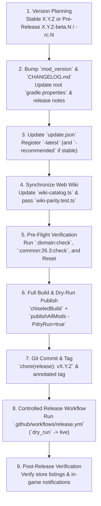

# Mod Version Administration & Release Runbook

This runbook outlines the operational lifecycle for versioning, validating, releasing, and publishing **`afkraft-companion-mod`** across GitHub Releases, Modrinth, and CurseForge.

Because this mod is built across **10 Stonecutter Minecraft release nodes (`1.21.1` to `26.3`)** for both **Fabric** and **NeoForge**, a single mod release simultaneously produces **20 distinct release JARs** (plus 20 sources JARs).

---

## Quick Reference: The Release Lifecycle



---

## 1. Semantic Versioning & Cross-Loader Pre-Release Contract

`afkraft-companion-mod` complies with **SemVer 2.0.0** AND **Apache Maven `ComparableVersion`** (used natively by NeoForge's `ModList` and `updateJSONURL`):

| Level | When to Bump | Example Transition | Release Channel |
|-------|--------------|--------------------|-----------------|
| **`ALPHA` / `BETA` / `RC`** | Closed tests, staged rollouts, or release candidates before stable. | `1.0.0-beta.1` -> `1.0.0-beta.2` -> `1.0.0` | `ALPHA` / `BETA` |
| **`PATCH`** | Backwards-compatible bug fixes, UI adjustments, translation fixes, or performance tweaks. | `1.0.0` -> `1.0.1` | `STABLE` |
| **`MINOR`** | New player-facing features, commands, or backwards-compatible backend integration changes. | `1.0.0` -> `1.1.0` | `STABLE` |
| **`MAJOR`** | Breaking network protocol overhauls, major schema shifts, or incompatible architectural changes. | `1.0.0` -> `2.0.0` | `STABLE` |

> [!CAUTION]
> **Never use bare `-pre` (e.g., `1.0.0-pre`) as a pre-release qualifier.**
> Maven's `ComparableVersion` (NeoForge) only treats `alpha`, `beta`, `milestone`, `rc`, and `snapshot` as pre-release qualifiers ordered before `1.0.0`. A bare `-pre` evaluates **greater** than `1.0.0` (`1-pre+-26.3 > 1`), which prevents NeoForge's Mods screen from notifying players when `1.0.0` stable ships. Always use `-alpha.<N>`, `-beta.<N>`, or `-rc.<N>` with a numeric suffix before `+`.

### Multi-Loader Artifact Nomenclature
The build scripts in `:fabric` and `:neoforge` suffix the Minecraft node version as build metadata:
```text
afkraft_companion-<loader>-<mod_version>+<minecraft_version>.jar
```
For example, release `1.0.0-beta.1` outputs:
- Fabric: `afkraft_companion-fabric-1.0.0-beta.1+1.21.1.jar` ... `afkraft_companion-fabric-1.0.0-beta.1+26.3.jar` (10 JARs)
- NeoForge: `afkraft_companion-neoforge-1.0.0-beta.1+1.21.1.jar` ... `afkraft_companion-neoforge-1.0.0-beta.1+26.3.jar` (10 JARs)

---

## 2. Step 1: Bump `mod_version` & Write `CHANGELOG.md`

1. Update `mod_version` in root [`gradle.properties`](./gradle.properties) (the single source of truth):
   ```properties
   mod_version=1.0.0-beta.1
   ```
   Do **not** hardcode version numbers in `fabric.mod.json`, `neoforge.mods.toml`, or subproject `build.gradle` files.
2. Add a matching `## [<mod_version>]` section at the top of [`CHANGELOG.md`](./CHANGELOG.md). Both `mod-publish-plugin` and `.github/workflows/release.yml` automatically extract this exact section as release notes.

---

## 3. Step 2: Update the Canonical `update.json` Manifest

The mod serves update metadata via root [`update.json`](./update.json) at:
```text
https://raw.githubusercontent.com/MARS42/afkraft-companion-mod/main/update.json
```

### Manifest Editing Rules
- **For pre-releases (`-alpha.N`, `-beta.N`, `-rc.N`)**:
  - Update `<mc_version>-latest` for all 10 nodes to the pre-release version.
  - **Do NOT** set `<mc_version>-recommended` to a pre-release (leave `<mc_version>-recommended` pointing to the last stable release, or omit it before `1.0.0` exists).
- **For stable releases (`X.Y.Z`)**:
  - Update both `<mc_version>-latest` and `<mc_version>-recommended` across all 10 nodes.
- Add a concise summary entry under each supported Minecraft version object.

---

## 4. Step 3: Synchronize the Player Wiki in `afkraft-companion-web`

Before tagging a release that changes player-facing behavior, synchronize the player Wiki in `afkraft-companion-web`:
1. Follow `afkraft-companion-web/docs/WIKI_WORKFLOW.md` (Zero Programming Jargon editorial rules).
2. Update `src/lib/wiki-catalog.ts` (`sinceModVersion`, `lastUpdatedModVersion`, and `WIKI_MOD_RELEASES`).
3. Run the automated Wiki parity test in `afkraft-companion-web`:
   ```bash
   node --experimental-strip-types --test test/wiki-parity.test.ts
   ```

---

## 5. Step 4: Mandatory Pre-Flight Verification & Dry-Run Publish

Run the complete local verification chain before committing or tagging:

```bash
./gradlew :domain:check --no-daemon
./gradlew :common:26.3:check --no-daemon
./gradlew "Reset active project" --no-daemon
./gradlew chiseledBuild --no-daemon
./gradlew publishAllMods -PdryRun=true --no-daemon
```

Verify that:
- `:domain:check` passes unit, version comparison, and architecture purity tests.
- `:common:26.3:check` passes localization parity (`en_us`, `es_es`, `es_mx`) and SPI checks.
- `"Reset active project"` leaves `common/`, `fabric/`, and `neoforge/` on `vcs_version` (`26.3`).
- `chiseledBuild` outputs all 20 release JARs + 20 sources JARs into `build/libs/`.
- `publishAllMods -PdryRun=true` succeeds across all 20 targets (validating changelog extraction, channel inference, loader tags, Java versions, and discrete Minecraft version arrays from `versions/*/gradle.properties`).

---

## 6. Step 5: Git Commit & Tagging

Use conventional commits and create an annotated tag matching `v<mod_version>`:

```bash
git add gradle.properties update.json CHANGELOG.md
git commit -m "chore(release): v1.0.0-beta.1"
git tag -a v1.0.0-beta.1 -m "Release v1.0.0-beta.1"
git push origin main
git push origin v1.0.0-beta.1
```

---

## 7. Step 6: Controlled Publishing (GitHub Releases, Modrinth & CurseForge)

### One-Time Repository Configuration
Configure these in GitHub **Settings -> Secrets and variables -> Actions**:
- **Repository Variables**:
  - `MODRINTH_PROJECT_ID` (from your Modrinth project settings)
  - `CURSEFORGE_PROJECT_ID` (numeric project ID from CurseForge Authors Console)
- **Repository Secrets**:
  - `MODRINTH_TOKEN` (Personal Access Token from Modrinth with version upload scope)
  - `CURSEFORGE_TOKEN` (API Token from CurseForge Authors Console)

### Triggering `.github/workflows/release.yml`
The release workflow runs **exclusively via manual `workflow_dispatch`** for explicit operator control:
1. Open **Actions -> Release & Publish Mod -> Run workflow** on `main` (or the release tag).
2. Run once with `dry_run = true` to verify all 20 builds and publish payloads in CI.
3. Run with `dry_run = false` and choose target flags (`publish_github`, `publish_modrinth`, `publish_curseforge`).
   - For the **very first submission**, keep the Modrinth project in **Draft** and CurseForge project **Unlisted** while uploading all 20 JARs, visually inspect the version matrix on both dashboards, and then click **Submit for Review** on Modrinth / publish the unlisted page on CurseForge.

---

## 8. Step 7: Post-Release Verification

| Environment | How to Verify | Expected Result |
|-------------|---------------|-----------------|
| **Fabric Client** | Launch with an older local version or join a world | Chat shows golden update notice with clickable `[Download Update]` button when `update.json` advances. |
| **NeoForge Client** | Open the **Mods** menu | NeoForge displays the update badge next to `AFKraft Companion` and renders the changelog from `update.json`. |
| **Dedicated Server** | Start server console | Console logs `[AFKraft Companion] An update is available: v...` on startup when outdated. |
| **Modrinth & CurseForge** | Inspect uploaded files for `1.21.8` and `26.3` | Fabric `1.21.8` lists `1.21.6–1.21.8` + required `Fabric API`; NeoForge `1.21.8` lists `1.21.8` + Java 21; `26.3` lists Java 25. |

---

## Release Checklist

- [ ] `mod_version` updated in root `gradle.properties` (never bare `-pre`).
- [ ] `CHANGELOG.md` updated with `## [<mod_version>]` section.
- [ ] `update.json` updated (`-latest` for pre-releases; `-latest` + `-recommended` for stable).
- [ ] Player Wiki synchronized in `afkraft-companion-web/src/lib/wiki-catalog.ts` and `test/wiki-parity.test.ts` passed.
- [ ] `./gradlew :domain:check` passed.
- [ ] `./gradlew :common:26.3:check` passed.
- [ ] `./gradlew "Reset active project"` executed.
- [ ] `./gradlew chiseledBuild` built all 20 release JARs.
- [ ] `./gradlew publishAllMods -PdryRun=true` succeeded for all 20 targets.
- [ ] Conventional commit (`chore(release): v<mod_version>`) and annotated tag pushed.
- [ ] `.github/workflows/release.yml` executed and verified across GitHub Releases, Modrinth, and CurseForge.
- [ ] Raw `update.json` URL verified reachable via HTTP GET.
