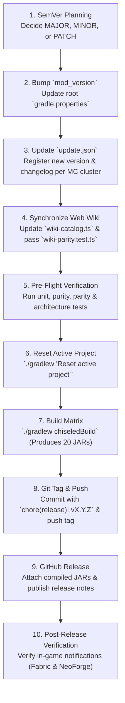

# Mod Version Administration & Release Runbook

This runbook outlines the operational lifecycle for versioning, validating, releasing, and notifying players of new updates for **`afkraft-companion-mod`**.

Because this mod is built across **10 Stonecutter Minecraft release nodes (`1.21.1` to `26.3`)** for both **Fabric** and **NeoForge**, a single mod release simultaneously produces **20 distinct release JARs**. Following this runbook ensures zero descriptor regressions, proper manifest synchronization, and reliable in-game player notifications.

---

## Quick Reference: The Release Lifecycle



---

## 1. Semantic Versioning Contract

`afkraft-companion-mod` strictly complies with **SemVer 2.0.0** (`MAJOR.MINOR.PATCH`):

| Level | When to Bump | Example Transition |
|---|---|---|
| **`PATCH`** | Backwards-compatible bug fixes, UI styling adjustments, translation fixes, or internal performance improvements. | `1.0.0` -> `1.0.1` |
| **`MINOR`** | New player-facing features, new commands, or backwards-compatible backend integration changes. | `1.0.0` -> `1.1.0` |
| **`MAJOR`** | Breaking network protocol overhauls, major schema shifts, or incompatible architectural migrations. | `1.0.0` -> `2.0.0` |

### Multi-Loader Artifact Nomenclature
The build scripts in `:fabric` and `:neoforge` automatically suffix the Minecraft version as build metadata:
```text
afkraft_companion-<loader>-<mod_version>+<minecraft_version>.jar
```
For example, release `1.0.1` outputs:
- Fabric: `afkraft_companion-fabric-1.0.1+1.21.1.jar` ... `afkraft_companion-fabric-1.0.1+26.3.jar` (10 JARs)
- NeoForge: `afkraft_companion-neoforge-1.0.1+1.21.1.jar` ... `afkraft_companion-neoforge-1.0.1+26.3.jar` (10 JARs)

> [!NOTE]
> Per the SemVer 2.0.0 specification, build metadata after the `+` is ignored during version precedence comparisons in `:domain`'s `SemanticVersion`. This allows the in-game update checker to cleanly compare the core `MAJOR.MINOR.PATCH` while ensuring players download the exact binary for their game version.

---

## 2. Step 1: Bump `mod_version` in `gradle.properties`

The root [`gradle.properties`](./gradle.properties) is the **single source of truth** for the mod version.

Update line 19 with the target release version:

```properties
# Mod Properties
mod_version=1.0.1
maven_group=com.mars4two.ikang
```

> [!IMPORTANT]
> Do **not** hardcode version numbers in `fabric.mod.json`, `neoforge.mods.toml`, or subproject `build.gradle` files. Gradle dynamically injects `${project.mod_version}` into all manifests and archive names.

---

## 3. Step 2: Update the Canonical `update.json` Manifest

The mod serves update metadata via the repository root [`update.json`](./update.json). This manifest is read natively by **NeoForge** via `updateJSONURL` and fetched by **Fabric** through `:domain`'s `UpdateCheckerService`.

Public raw endpoint:
```text
https://raw.githubusercontent.com/MARS42/afkraft-companion-mod/main/update.json
```

### Manifest Editing Guidelines
When publishing version `1.0.1`:

1. **Update `promos`**:
   - Update `<mc_version>-latest` for all Minecraft versions covered by this release.
   - If this release is considered stable and recommended for production servers, also update `<mc_version>-recommended`.
2. **Add the changelog block**:
   - Under each supported Minecraft version object (e.g., `"1.21.1"`, `"26.3"`), add a new key with the mod version and a brief release summary.

```json
{
  "homepage": "https://github.com/MARS42/afkraft-companion-mod",
  "promos": {
    "1.21.1-latest": "1.0.1",
    "1.21.1-recommended": "1.0.1",
    "1.21.3-latest": "1.0.1",
    "1.21.3-recommended": "1.0.1",
    "1.21.4-latest": "1.0.1",
    "1.21.4-recommended": "1.0.1",
    "1.21.5-latest": "1.0.1",
    "1.21.5-recommended": "1.0.1",
    "1.21.8-latest": "1.0.1",
    "1.21.8-recommended": "1.0.1",
    "1.21.10-latest": "1.0.1",
    "1.21.10-recommended": "1.0.1",
    "1.21.11-latest": "1.0.1",
    "1.21.11-recommended": "1.0.1",
    "26.1.2-latest": "1.0.1",
    "26.1.2-recommended": "1.0.1",
    "26.2-latest": "1.0.1",
    "26.2-recommended": "1.0.1",
    "26.3-latest": "1.0.1",
    "26.3-recommended": "1.0.1"
  },
  "1.21.1": {
    "1.0.0": "Initial release",
    "1.0.1": "Update notification system and minor stability fixes"
  },
  "26.3": {
    "1.0.0": "Initial release",
    "1.0.1": "Update notification system and minor stability fixes"
  }
}
```

---

## 4. Step 3: Synchronize the Player Wiki in `afkraft-companion-web`

Documentation synchronization is a **blocking release priority**. Before running pre-flight verification or tagging a new mod release, ensure the player-facing Wiki in `afkraft-companion-web` reflects every new or modified feature for `mod_version`:

1. **Follow the Canonical Wiki Workflow**:
   - Refer to `afkraft-companion-web/docs/WIKI_WORKFLOW.md` for the **Zero Programming Jargon** editorial rules and 4-part article template (*¿Qué es?*, *¿Para qué sirve?*, *¿Cómo se usa paso a paso?*, *Disponible desde*).
2. **Update `src/lib/wiki-catalog.ts` in `afkraft-companion-web`**:
   - If the release adds or changes a `SnapshotType`, command (`/afkraft ...`), keybind, container mode, or screen, update the corresponding `es` and `en` article with `sinceModVersion` / `lastUpdatedModVersion`.
   - Append a new entry to `WIKI_MOD_RELEASES` summarizing in plain player language what changed in this version and why it helps players in their worlds/farms.
3. **Run the Automated Wiki Parity & Jargon Gate** in `afkraft-companion-web`:
   ```bash
   node --experimental-strip-types --test test/wiki-parity.test.ts
   ```

---

## 5. Step 4: Mandatory Pre-Flight Verification

Before tagging or pushing, run all validation suites locally.

### 1. Pure Domain Verification (Purity & Unit Tests)
```bash
./gradlew :domain:check --no-daemon
```
Verifies:
- All domain unit tests (`SemanticVersionTest`, `UpdateCheckerServiceTest`, `MobSphereDomainCalculatorTest`, etc.) pass.
- `DomainArchitecturePurityTest` confirms zero `net.minecraft.*`, `net.fabricmc.*`, or `net.neoforged.*` imports in `:domain`.

### 2. Localization Parity & Architecture SPI Verification
```bash
./gradlew :common:26.3:check --no-daemon
```
Verifies:
- `LocalizationParityTest`: All keys in `AFKraftTranslations` exist in `en_us.json`, `es_es.json`, and `es_mx.json` with identical argument counts; zero prohibited `Component.literal` calls exist.
- `CommonArchitectureAndSpiTest`: All SPI descriptors (`PlatformInfoHooks`, `ClientLifecycleHooks`, etc.) are registered and contain zero loader leakage.

### 3. Stonecutter Source Reset
```bash
./gradlew "Reset active project" --no-daemon
```
> [!CAUTION]
> Always run `"Reset active project"` before committing. This ensures active sources in `common/`, `fabric/`, and `neoforge/` remain aligned with `vcs_version` (`26.3`).

---

## 5. Step 4: Build All 20 Release JARs

Compile and verify all 10 Stonecutter compatibility nodes across both loaders:

```bash
./gradlew chiseledBuild --no-daemon
```

After compilation, verify that all 20 JARs are present in `build/libs/` or their respective module build folders:
- 10 Fabric JARs (`fabric/versions/<mc_ver>/build/libs/`)
- 10 NeoForge JARs (`neoforge/versions/<mc_ver>/build/libs/`)

---

## 6. Step 5: Git Commit & Tagging

Use conventional commit messages and create an annotated Git tag matching `v<mod_version>`:

```bash
# Stage changes (gradle.properties, update.json, and code/docs)
git add gradle.properties update.json

# Commit release metadata
git commit -m "chore(release): v1.0.1"

# Create annotated release tag
git tag -a v1.0.1 -m "Release v1.0.1"

# Push commit and tags to origin
git push origin main
git push origin v1.0.1
```

---

## 7. Step 6: GitHub Actions & Release Publishing

When the tag `v1.0.1` is pushed:
1. GitHub Actions runs `.github/workflows/build.yml` to compile and validate all 10 Minecraft nodes in parallel.
2. The `collect` job gathers all 20 artifacts.
3. In **GitHub Releases**:
   - Draft a new release for `v1.0.1`.
   - Title: `AFKraft Companion v1.0.1`.
   - Paste the changelog notes.
   - Attach the compiled release JARs.
   - Publish the release.

---

## 8. Step 7: Post-Release In-Game Verification

Once the release is published, verify the update flow in game:

| Loader / Environment | How to Test | Expected Behavior |
|---|---|---|
| **Fabric Client** | Run `./gradlew :fabric:26.3:runClient` with a locally lowered version (or test with a world join). | Upon joining a world, a golden message appears in chat: `Nueva versión de AFKraft Companion disponible: 1.0.1 (instalada: 1.0.0). [Descargar actualización]`. Clicking the link opens the release URL. |
| **NeoForge Client** | Run `./gradlew :neoforge:26.3:runClient`. | Open the **Mods** menu: NeoForge displays the update badge next to `AFKraft Companion`, and shows the changelog from `update.json`. |
| **Dedicated Server** | Run `./gradlew :fabric:26.3:runServer` or `:neoforge:26.3:runServer`. | Server console logs: `[AFKraft Companion] An update is available: v1.0.1 (running: v1.0.0). Download: https://...` on startup. |

---

## Release Checklist

Copy this checklist into release issues or PR descriptions:

- [ ] `mod_version` bumped in root `gradle.properties`.
- [ ] `update.json` updated with new version in `promos` (`-latest` / `-recommended`) and changelog entries.
- [ ] Player Wiki synchronized in `afkraft-companion-web/src/lib/wiki-catalog.ts` (`sinceModVersion`, `lastUpdatedModVersion`, and `WIKI_MOD_RELEASES`) and verified via `node --experimental-strip-types --test test/wiki-parity.test.ts`.
- [ ] `./gradlew :domain:check` passed.
- [ ] `./gradlew :common:26.3:check` passed (architecture and localization tests green).
- [ ] `./gradlew "Reset active project"` executed (canonical sources on `26.3`).
- [ ] `./gradlew chiseledBuild` succeeded (20 JARs built).
- [ ] Git commit created (`chore(release): vX.Y.Z`).
- [ ] Annotated tag pushed (`vX.Y.Z`).
- [ ] GitHub Release created with attached JARs.
- [ ] Raw `update.json` URL verified reachable via HTTP GET.
